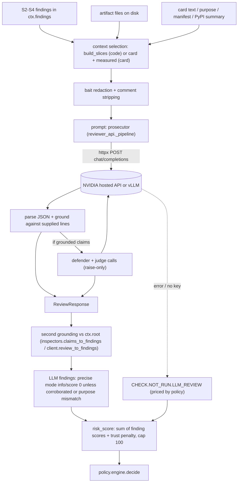

# Checks inventory (static, deep, LLM)

Commit `24af4c9`. One row per **checker** (module/function), with every finding code it can emit grouped in the row; splitting every regex into its own row was not done. "Test" = test files that reference the finding ids (grep-level; individual assertions were not all read). Severity/points: `info 0, low 5, medium 12, high 25, critical 40` (`lineage/risk.py::SEVERITY_WEIGHT`) unless a row says otherwise. "Real algorithm" vs "heuristic" is stated per row.

## A. Static review (S2 provenance + S3 static)

| # | Checker (file::function) | Types | Detects | Input | Approach | Libs | Finding codes (severity) | Runs when | Limitations | Test |
|---|---|---|---|---|---|---|---|---|---|---|
| 1 | `pipeline.py::_identify`, `_hash_files`, `_tensor_hashes` (S1) | all | integrity baseline; malformed safetensors | files | SHA-256 per file, Merkle root, per-tensor hash | hashlib, `hashing/*` | `MODEL.FORMAT.MALFORMED_SAFETENSORS` (high), `INTAKE.DIGEST.KNOWN` (info), `INTAKE.PASSPORT.MALFORMED` (medium), `INTAKE.REF.NOT_FOUND` (high) | always | hashing only records; a hash change has no meaning without a reference | test_intake_pipeline, test_origin |
| 2 | `inspectors.py::origin_check` (S2a) | all | upload that claims a hub origin but differs | file hashes vs `hub.published_files` | exact sha256 / git-oid comparison per file | none | `PROV.ORIGIN.MODIFIED` (critical; hard block in staging/prod), `.UNVERIFIABLE` (high), `.UNCLAIMED` (medium), `.VERIFIED`/`.HINT` (info) | always | needs a claimed origin and a reachable hub; hints from config/README are `declared` | test_origin |
| 3 | `publisher_policy` (S2c) | all | blocked / look-alike / unlisted publisher | facts | fnmatch block list; Levenshtein ≤2 vs allow list | none | `PROV.PUBLISHER.BLOCKED` (high), `PROV.LOOKALIKE.PUBLISHER` (high; engine: high=quarantine), `.UNVERIFIED` (medium), `.UNLISTED` (low) | always | allow list applies only to trusted facts | test_facts, test_intake_pipeline |
| 4 | `signed_passport` (S2b) | all | creator passport: signature, trusted key, scope, expiry, hashes | shipped passport | Ed25519 verify over canonical JSON; key must be in `policy.trusted_publishers` (or dev `LINEAGE_TRUSTED_KEYS` if none listed); fnmatch scope; file hashes vs pinned | cryptography | `PROV.SIGNATURE.INVALID` (critical, hard), `.UNTRUSTED_KEY` (medium), `.REVOKED_KEY` (high), `.SCOPE_MISMATCH` (high), `PROV.PASSPORT.EXPIRED` (medium), `INTEGRITY.HASH_MISMATCH` (critical, hard), `INTEGRITY.UNPINNED_FILE` (medium) | only if a passport ships | key trust is policy-only | test_signature_scope, test_intake_pipeline |
| 5 | `parent_chain` | all | parent revoked/unknown/not admitted | `ctx.parents` | registry status lookup | none | `PROV.PARENT.REVOKED` (critical, hard), `.UNKNOWN` (medium), `.NOT_ADMITTED` (high) | parents present | parents from verified passport or identified weights | test_intake_pipeline |
| 6 | `licence` | all | licence not allowed / only declared | fact `licence` | list membership | none | `POLICY.LICENCE.NOT_ALLOWED` (medium; engine quarantine), `.UNVERIFIED` (low) | licence fact and allow list | metadata lookup only | test_facts |
| 7 | `release_age` | pkg, model, dataset, tool | cooldown cannot be cleared | trusted `released_at` | presence check | none | `PROV.COOLDOWN.UNVERIFIED` (medium, **score 0**; engine quarantines) | cooldown configured | needs fetched/signed date | test_facts, test_origin |
| 8 | `package_provenance` (S2) | package | look-alike name, repo mismatch, repo owner, maintainer change, release age | PyPI JSON metadata | Damerau-Levenshtein + affix/digit/transposition rules vs `data/top_pypi_5k.txt`; repo URL regex; `CANONICAL_OWNERS` table | stdlib | `PKG.PROV.LOOKALIKE_NAME` (critical/high), `.LOOKALIKE_REPO` (critical), `.REPO_MISMATCH` (high), `.REPO_OWNER_MISMATCH` (critical/high), `.REPO_INCONSISTENT` (medium), `.MAINTAINER_CHANGED` (medium), `.COOLDOWN` (high/medium) | metadata present, else `CHECK.NOT_RUN.PKG_METADATA` | heuristic; owner table is 40 projects; maintainer change needs previous metadata | test_inspect_package_meta, test_precision |
| 9 | `model_pickle` → `inspect/model_pickle.py::scan` | model | code on load | `.pkl .pt .pth .bin .ckpt .joblib` | `pickletools.genops` opcode walk (never unpickles); classify globals dangerous/safe/unknown | pickletools, zipfile | `MODEL.PICKLE.DANGEROUS_GLOBAL` (critical if called, else high; hard), `.PRESENT` (low), `.UNKNOWN_GLOBAL` (low), `.UNRESOLVED_GLOBAL` (high), `.UNPARSEABLE` (medium); policy `allow_pickle=false` is a hard block | pickle-like files exist | stack-depth approximated ("every global seen is treated as called") | test_inspect_model_pickle_config |
| 10 | `model_config` → `inspect/model_config.py::scan` | model | `trust_remote_code`, `auto_map` custom code | config JSONs, `.py` files | JSON field checks; if custom code, runs `package_capabilities.scan` + `package_taint.scan` on the model dir | stdlib | `MODEL.CONFIG.TRUST_REMOTE_CODE` (high), `.AUTO_MAP` (high/medium), `.EXTERNAL_CODE` (high), `.AUTO_MAP_MISSING` (medium), `.CUSTOM_CODE` (medium) + package findings | always | | test_inspect_model_pickle_config |
| 11 | `model_tokenizer` → `inspect/tokenizer.py::scan` | model | added suspicious tokens; (with base) remapped/new/removed tokens, merges, normalizer/post-processor, special flags | tokenizer files | JSON parse; regex (URL, instruction, invisible); set/dict diff vs base | stdlib | `MODEL.TOKENIZER.SUSPICIOUS_TOKEN` (high), `.NO_BASE`/`.ADDED_TOKENS_UNCHECKED` (info), and with a base: `.REMAPPED` (high), `.NEW_TOKENS`/`.REMOVED_TOKENS`/`.ADDED_TOKENS` (medium), `.SPECIAL_TOKEN_REMAPPED` (critical/high), `.SPECIAL_FLAG_CHANGED` (high), `.MERGES_CHANGED` (high), `.<PART>_CHANGED` (high post_processor else medium), `.MODEL_FILE_CHANGED` (high), `.SPECIAL_TOKEN_CHANGED` (medium) | in S3 **no base is passed**; diff runs only in S4 (rows 25-26) | needs a base tokenizer | test_inspect_tokenizer_template, test_template_tokenizer_fixes |
| 12 | `model_chat_template` → `inspect/chat_template.py::scan` | model | hidden instructions, trigger branches, SSTI, URLs, role remap, hidden tool calls | `chat_template` in tokenizer_config / `*.jinja` | **Jinja AST analysis**: tracks message-text variables, finds conditionals comparing text to literals, inspects emitted literals; regexes `MODEL_DIRECTED`, `SSTI`, URL; optional diff vs known-good | jinja2 | `MODEL.TEMPLATE.TRIGGER_BRANCH`, `.HIDDEN_INSTRUCTION`, `.CONDITIONAL_INSTRUCTION`, `.SSTI` (critical), `.URL` (critical if message data appended, else low), `.INVISIBLE_UNICODE`, `.ROLE_REMAP`, `.HIDDEN_TOOL_CALL`, `.CONTENT_CONDITIONAL` (high/info), `.DIFF_FROM_KNOWN_GOOD` (critical/high/medium), `.EMBEDDED_INSTRUCTION` (info), `.UNPARSEABLE` (medium) | templates exist | real AST for structure, but instruction detection is regex | test_inspect_tokenizer_template, test_template_tokenizer_fixes, test_precision |
| 13 | `dataset_format` | dataset | pickle in dataset | file suffix | suffix check | none | `DATA.FORMAT.PICKLE` (high) | `.pkl/.pickle` | | **no test references the id** |
| 14 | `dataset_pii` → `inspect/dataset_pii.py::scan` | dataset | PII/secrets | text files ≤200 MB | per-line regex + **Luhn** (cards), **Verhoeff** (Aadhaar) validators; masked examples | stdlib | `DATA.PII.<KIND>`: private_key/api_secret critical, ssn/credit_card/aadhaar/pan high, email/phone medium, ip low; engine blocks any `DATA.PII*` when `pii_allowed=false` | always | regex; IP counts as PII (60 "IP addresses" in the demo poisoned set triggered a block reason) | test_inspect_dataset, test_policy_engine |
| 15 | `dataset_stats` → `inspect/dataset_stats.py::scan` | dataset | duplicates, conflicting labels, label errors, class/row-count claims vs card, trigger tokens | tabular rows (≤100k) | exact dup by normalised text; **MinHash+LSH** near-dups (Jaccard 0.8); **confident learning** via cross-validated TF-IDF + logistic regression; trigger-token heuristic (remove token group, re-predict) | numpy, scikit-learn | `DATA.STATS.EXACT_DUPLICATES`/`NEAR_DUPLICATES` (low/medium), `.CONFLICTING_LABELS` (high), `.LABEL_ERRORS` (low/medium/high by rate), `.TRIGGER_TOKEN` (high), `.CLASS_BALANCE_MISMATCH`/`ROW_COUNT`/`CLASS_COUNT` (medium/high), `.IMBALANCED` (low), summary/skipped (info) | tabular file present | classical ML on TF-IDF, not embeddings; registered S3 but findings tagged S4 | test_inspect_dataset |
| 16 | `package_osv` → `inspect/package_osv.py::scan` | package | known vulnerabilities / malicious advisory | name+version | OSV API `/v1/query`, 6 h cache, shipped snapshot `examples/advisories_cache.json`; `LINEAGE_OFFLINE` = cache/snapshot only | httpx | `PKG.OSV.MALICIOUS` (critical, hard block), `PKG.OSV.VULN` (by advisory severity; ≥2 collapse into `PKG.OSV.GROUP` for scoring), unreachable → `CHECK.NOT_RUN.OSV` | package | version `0.0.0`/unknown skipped | test_inspect_package_meta |
| 17 | `package_baseline` | package | (context) previous release for diff-aware review | wheel | `package_previous.py`: PyPI JSON + `pip download --no-deps --only-binary` unpacked (never built) | pip | `PKG.BASELINE.COMPARED`/`.NONE` (info) | skipped when offline | | none |
| 18 | `package_capabilities` → `inspect/package_capabilities.py::scan` | package, tool (+model custom code) | capabilities and hooks | Python AST of all `.py`, `.pth`, setup files, npm lifecycle | **AST visitor**: network, filesystem, subprocess, env/secret, dynamic exec, encoded blob, obfuscation; hooks (.pth, sitecustomize, setup.py); signals are `info`; findings only for combos, hooks, decoded-exec, and release diff | ast | `PKG.SIGNAL.*` (info), `PKG.COMBO.CREDENTIAL_EXFIL`/`OBFUSCATED_PAYLOAD`/`FETCH_AND_RUN`/`IMPORT_TIME_EXEC` (critical), `PKG.HOOK.STARTUP_HOOK` (critical; hard if new), `.NETWORK_AT_INSTALL`/`.INSTALL_EXEC` (high), `.CUSTOM_INSTALL(_EXEC)`, `PKG.CODE.DECODE_EXEC` (critical, hard), `.DELAYED_EXEC` (critical), `.BAIT_ON_RISKY_CODE` (critical), `PKG.NEW.SUBPROCESS`/`DYNAMIC_EXEC`/`NETWORK_HOST`/`CREDENTIAL_PATH` (high), `.NEW.NETWORK` (medium) | code present; `PKG.NEW.*` only with a previous release | Python only (npm lifecycle scripts by regex) | test_inspect_capabilities, test_precision |
| 19 | `package_taint` → `inspect/package_taint.py::scan` | package, tool | source→sink data flow | Python AST, intra-procedural | **taint slicer** with budget (partial → `CHECK.NOT_RUN.TAINT_PARTIAL`, low) | ast | `PKG.TAINT.CREDENTIAL_EXFIL`/`ENV_EXFIL`/`REMOTE_EXEC`/`ENCODED_EXEC` (critical), `.FILE_UPLOAD` (info) | code present | intra-procedural only | test_inspect_taint |
| 20 | `package_rules` → `inspect/package_rules.py::scan` | package, tool | atexit effect, import hook, run-time-built target, .git/hooks write, beacon thread | AST | pattern rules over AST (`_fold` evaluates literal-only strings) | ast | `PKG.RULE.ATEXIT_EFFECT`, `.IMPORT_HOOK`, `.OBFUSCATED_TARGET`, `.GIT_HOOK_WRITE`, `.BEACON_THREAD` (high; some `info` when benign) | code present | rules, not dataflow | test_package_rules |
| 21 | `tool_description` → `inspect/tool_description.py::scan` | tool | tool poisoning in manifest text | every string in `manifest.json` | regex families (agent-addressed, shadowing), HTML comments, base64/hex decode-then-scan, invisible Unicode (+ tag-char decode), URLs/markdown images | stdlib | `TOOL.DESC.AGENT_INSTRUCTION`, `.SHADOWING`, `.INVISIBLE_UNICODE`, `.HTML_COMMENT`, `.ENCODED_TEXT`, `.MARKDOWN_IMAGE`, `.URL`, `.VERY_LONG`, `.UNREADABLE`; no manifest → `TOOL.MANIFEST.MISSING` (high) | tool | regex | test_inspect_tool, test_precision |
| 22 | `tool_intent` → `inspect/tool_intent.py::scan` | tool | code capability vs declared permissions | manifest `permissions` vs capabilities | keyword match of declared permissions against extracted capabilities | stdlib | `TOOL.INTENT.UNDECLARED_<CAP>` (high/medium/critical), `.UNDECLARED_CREDENTIAL_READ` (critical), `.STARTUP_HOOK` etc. (critical), `.UNUSED_<CAP>` (info) | tool with manifest | keyword heuristic | test_inspect_tool |
| 23 | MCP pin | tool | rug-pull | description + code hashes | `mcp_gateway.gateway.pin_tool` stored in `tool_pins` at S7; enforcement in the gateway at call time | hashlib | n/a (not a finding) | tool with manifest | gateway **not audited here** | test_mcp_gateway (not read) |

Policy-only rules in `lineage/policy/engine.py` (not scanners): banned capability (id substring or alias match → hard block), blocked publisher (hard), `max_vuln_severity` per env (`PKG.OSV.*` over limit → block), `IDENTITY_IDS` (critical block / high quarantine), `DATA.PII*` (block unless `pii_allowed`), licence (quarantine), `min_trust` per env (quarantine), `require_human_approval` (quarantine).

## B. Deep review (S4)

| # | Check | Types | Security question | File::function | Input | Algorithm | Libs | CPU/GPU/API | Reference needed | Output | Severity | Conditions / skip reason | Runs in default demo? | Limitations | Test |
|---|---|---|---|---|---|---|---|---|---|---|---|---|---|---|---|
| 24 | Local parent ID | model | Is this a fine-tune of an already admitted model? | `inspectors.py::local_parent_diff`; `diff/parent.py::fingerprint_parent`; `diff/layers.py::diff_models` | safetensors dir | per-tensor relative L2 vs every admitted model on local disk; similarity = mean 1/(1+relL2); ≥0.5 = parent; identical bytes → `IDENTICAL` | numpy | CPU; reads candidate from disk (no model load) | admitted models with `file://` source (`SqliteRegistry.reference_models`) | `MODEL.PARENT.IDENTIFIED` (info), `.IDENTICAL` (info), `.UNIDENTIFIED` (low +5), `.CLAIM_MISMATCH` (medium), `MODEL.WEIGHTS.CHANGED_LAYERS` (info), template/tokenizer diff vs parent | no safetensors / empty bank → `CHECK.NOT_RUN.PARENT_ID` (prod medium +12) | **yes** (empty bank → NOT_RUN; identical on a repeat) | trust of the reference = it was admitted here; threshold 0.5 is low for near relatives | test_intake_pipeline, test_hub_parent |
| 25 | Hub parent | model | Does the weights match the named base? | `inspectors.py::hub_parent`; `diff/hub_parent.py::compare` | claimed `base_model` | HTTP range requests: base config, tokenizer, safetensors header, 512 embedding rows; mean row cosine ≥0.90 | httpx, numpy | CPU + network | named base on the hub | `MODEL.PARENT.IDENTIFIED` (info), `.CLAIM_MISMATCH` (high), tokenizer diff vs base, `MODEL.PARENT.NO_CLAIMED_BASE` (info) | unreachable/no tensor → `CHECK.NOT_RUN.PARENT_FETCH` | runs; in the demo no base is named so it reports `NO_CLAIMED_BASE` | only the embedding slice is compared | test_hub_parent |
| 26 | Template/tokenizer diff vs parent | model | Did the fine-tune change the chat template/tokenizer? | `_template_vs_parent`, `tokenizer.scan(child, parent)` | child + identified parent | see rows 11-12 | | CPU | an identified parent | `MODEL.TEMPLATE.DIFF_FROM_KNOWN_GOOD`, tokenizer findings | only when a parent is found | when a parent exists | | | test_hub_parent, test_inspect_tokenizer_template |
| 27 | Weight-space backdoor (spectral) | model | Do changed layers look like a backdoor fine-tune? | `inspectors.py::gpu_weights` → `POST /weights/parent` then `/weights/spectral` (`gpu_worker/weights_api.py::spectral_score`) | model path **on the worker's disk** | ΔW singular values per changed 2-D weight (LoRA via QR trick); 5 metrics (energy conc., kurtosis, entropy, Frobenius, top SV), mean/max aggregates, z-scored, logistic regression from `gpu_worker/calibration/weightspace_model.json` | torch, numpy | **GPU worker** (module imports torch; SVD can run on CPU, **UNVERIFIED**); calibration file | worker's `models.yaml` bank (7 base models) or `parent` | `MODEL.WEIGHTS.SPECTRAL_ANOMALY`: high ≥0.8, medium ≥0.5 (`SPECTRAL_HIGH/MEDIUM`) | worker unreachable → `CHECK.NOT_RUN.WEIGHT_BACKDOOR` (prod medium +12); worker rejects (HTTP 4xx) → NOT_RUN with "cannot analyse this model"; no parent → NOT_RUN "no parent identified"; calibration missing → 503 → NOT_RUN | **NO** (priced NOT_RUN) | benchmark AUROC 0.81/0.78 on LoRA only (handoff claim, not re-run); calibrated on a small bank | test_intake_pipeline (fake worker); test_gpu_weights **not collected here** |
| 28 | Behaviour diff | model | Does the child behave differently from the parent? | `gpu_weights` → `POST /behaviour/diff` (`behaviour_api.py::behaviour_diff_impl`) | child, parent, probe set `safety-default` | greedy generation on probes, teacher-forced Jensen-Shannon divergence per probe, refusal-flip regex | torch, transformers | **GPU required** (`_need_gpu` → 503) | parent model loadable on worker | `MODEL.BEHAVIOUR.DIVERGENCE`: high ≥0.30, medium ≥0.10 | same skip rules → `CHECK.NOT_RUN.BEHAVIOUR_DIFF` | **NO** | loads both models on the worker | test_intake_pipeline (fake); test_gpu_behaviour_notary **not collected here** |
| 29 | Notary spot-check | model | Does the model still match its certified behaviour? | `gpu_weights` → `/notary/check` | verified creator passport with `certificates` | re-answers a random subset of certified hidden items, compares to stored answers (≥ agreement threshold) | torch | **GPU required** | certificate stored on that worker | `MODEL.NOTARY.MISMATCH` (high), `.NOT_APPLICABLE` (info) | no cert → not applicable; worker down → `CHECK.NOT_RUN.NOTARY` | **NO** | certificates exist only on the issuing worker | test_intake_pipeline (fake) |
| 30 | Dataset poisoning v2 | dataset | Hidden triggers, injected content, invisible characters, spectral/kNN outliers | `inspectors.py::dataset_v2` → `inspect/dataset_v2.py::scan` | rows (≤200k; csv/jsonl/json/parquet*) | (1) character checks; (2) injection regexes; (3) **trigger→behaviour**: rare n-grams in prompts whose responses are near-identical (CountVectorizer 1-4-grams, null distribution by random draws, z>3, guards); (4) label trigger via held-out classifier; (5) **spectral signature** (SVD per label, bimodality coefficient); (6) **kNN** label disagreement (≥80% of 10 neighbours) | numpy, scikit-learn; hosted embeddings if `LINEAGE_EMBED_MODEL` | CPU; API optional (silently falls back to TF-IDF+SVD on error) | none | `DATA.CHARS.*` (low-high), `DATA.INJECT.OVERRIDE/EXEC/SECRET` (high), `.MARKDOWN_IMAGE` (medium), `.URL` (low/info), `DATA.TRIGGER.BEHAVIOUR` (high), `DATA.TRIGGER.LABEL` (high), `DATA.SPECTRAL.OUTLIERS` (low/medium), `DATA.KNN.LABEL_DISAGREE` (low/medium) | parquet without pyarrow → `CHECK.NOT_RUN.PARQUET`; truncated → `CHECK.NOT_RUN.FULL_SCAN` (low) | **yes** (the demo's 5% backdoor produced `DATA.TRIGGER.BEHAVIOUR`) | 1% poisoning mostly missed (handoff); trigger needs ≥50 rows | test_dataset_v2; spectral, kNN, label-trigger ids are not referenced by name |
| 31 | Dataset upstream diff | dataset | What changed vs the earlier version? | `inspectors.py::dataset_upstream_diff` → `inspect/dataset_diff.py::diff` | new vs previous version (hub `previous_path` or latest admitted same-name dataset) | normalised-row hash set difference, label flips, total-variation balance drift, tokens concentrated in added rows | stdlib | CPU | previous version | `DATA.DIFF.ADDED_ROWS` (low/medium), `.LABELS_FLIPPED` (medium/high), `.NEW_TOKENS` (high), `.BALANCE_DRIFT` (medium), summary (info) | none known → `DATA.DIFF.NO_BASELINE` (info) | **yes** (demo: 60 rows added) | name match decides "previous" | test_dataset_v2 |
| 32 | Package dependency closure | package | Are dependencies admitted? | `inspectors.py::package_dependency_closure` | `requires_dist` | PEP 508 name parse; registry status lookup; ghost nodes for the graph | none | CPU | registry | `PKG.DEP.UNREGISTERED` (low), `.RESOLVED`/`.NONE` (info) | no fetched metadata → `PKG.DEP.NONE` | yes | transitive deps not resolved | test_graph_monitor |
| 33 | Deeper package code analysis | package | (see rows 18-20, run in S3) | | | | | | | | | | | The "deep" package work (taint, combos) actually runs in S3 in this build | |

Deep-review checks listed in the brief that **do not exist** as separate checks: dataset confident learning is in S3 (`dataset_stats`, row 15); there is no separate dataset-spectral GPU path; no MCP deep implementation analysis beyond S3 `tool_intent`; no sandboxed dynamic analysis (PLANNED in the handoff).

## C. LLM review (S5)

| # | Operation | Purpose | File::function | Exact inputs | Prompt | Model/API/package | Output schema | Grounding | Risk effect | Failure behaviour | Test |
|---|---|---|---|---|---|---|---|---|---|---|---|
| L1 | Code review request build | decide what code the LLM sees | `inspectors.py::gpu_code_review`, `llm_review/client.py::build_slices` | **slices only**: taint slices, ±3 lines around capability hits, ±2/+4 around hooks, ±3 around every file:line evidence of any non-info finding; comments replaced by `# [comment removed]`; max 20 slices; purpose (trusted fact or PyPI summary, ≤4000 chars); capability names; diff vs previous (≤20,000 chars) | n/a | n/a | `ReviewCodeRequest` | n/a | none | no slices → `LLM.REVIEW.NOTHING_TO_REVIEW` (info) | test_inspect_llm_review (build_slices) |
| L2 | Prosecutor | find unexplained behaviour | `gpu_worker/reviewer_api.py::_pipeline`, `CODE_PROSECUTOR` | numbered, bait-redacted slices (≤24,000 chars) + purpose + capabilities | `reviewer_api.py` strings | hosted: `httpx` POST `{LINEAGE_LLM_BASE_URL or https://integrate.api.nvidia.com/v1}/chat/completions`, default model **`nvidia/nemotron-3.5-lightning-30b-a3b`** (`LINEAGE_LLM_MODEL`), `temperature 0`, `enable_thinking=false`, JSON schema `response_format` with fallback to JSON-in-prompt; or self-hosted vLLM (`LINEAGE_VLLM_URL`, served name `reviewer`, `models.yaml: nvidia/NVIDIA-Nemotron-Nano-9B-v2`) | `PROSECUTOR_SCHEMA` {analysis, claims[≤8]{text,file,line,api,severity,purpose_mismatch?}, verdict} | each claim: file known, line within supplied lines, `api` on that line (`reviewer_api.ground`) | see L5 | `ReviewerUnavailable` → HTTP 503 → intake emits `CHECK.NOT_RUN.LLM_REVIEW` | test_gpu_reviewer (**not collected here**), test_hosted_reviewer (stubbed `httpx.post`) |
| L3 | Defender | benign explanation per claim | same, `CODE_DEFENDER` | slices + numbered grounded prosecutor claims | | same | `DEFENDER_SCHEMA` {rebuttals} | n/a | **ignored for scoring**: the judge may only raise severity | **only runs if ≥1 grounded prosecutor claim** | as above |
| L4 | Judge | rate severities, add ≤3 extra claims, verdict | same, `CODE_JUDGE` | slices + claims + rebuttals | | same | `JUDGE_SCHEMA` | extras grounded; severity can only be raised (`SEV[new] > SEV[old]`) | verdict floored by `_verdict`: no claims → at most suspicious; critical claim → malicious; benign verdict turns claims to `info` | as above | as above |
| L5 | Findings conversion | LLM claims → findings | `llm_review/client.py::review_to_findings`, `_to_finding`, `_corroborated` | `ReviewResponse` + root + static findings | | | `Finding(source="llm")` | **second grounding pass** against real files (`llm_review/grounding.py::ground_claims_with_reasons`: file exists under root, line in range, not a comment, API on the comment-stripped line) | **precise mode (default)**: a claim adds points only if a deterministic finding is within 2 lines in the same file, or `purpose_mismatch`; otherwise `info`, score 0. Severity capped by verdict ceiling (benign→low, suspicious→medium, malicious→high) unless corroborated | transport error → `LLM.REVIEW.SKIPPED` converted by `gpu_code_review` into `CHECK.NOT_RUN.LLM_REVIEW`; dropped claims → `LLM.REVIEW.UNGROUNDED_DROPPED` (info, 0) | test_inspect_llm_review |
| L6 | Card review | card vs measured facts | `inspectors.py::gpu_card_review`, `CARD_PROSECUTOR/DEFENDER/JUDGE` | card text (≤ budget) + `measured` = {file count, claimed base, sorted `id:severity` list of **all earlier findings**}; **no files, weights or dataset rows** | | same model; hosted if `ctx.gpu_url is None` and a key exists and `LINEAGE_GPU_URL` unset (`GpuClient.hosted`), else worker `/review/card` | same schemas | **re-grounded against `ctx.root`** (see audit §2 item 2: claims citing `card.md`/`measured.json` are dropped) | `LLM.CARD.CLAIM` scores full severity weight (no precise-mode capping in `claims_to_findings`) | no card → `LLM.CARD.MISSING` (low +5); backend down → `CHECK.NOT_RUN.LLM_REVIEW` | test_intake_pipeline (fake worker citing README.md) |
| L7 | Card vs policy | org policy against the card | `gpu_card_review` → `llm_review/policy_hosted.py::check` | card lines (≤400) + policy rules | `policy_hosted.check` system prompt | hosted only, default `nvidia/nemotron-3.5-lightning-30b-a3b` (`LINEAGE_POLICY_MODEL`) | {violations:[{line,reason}]}; line must exist and be non-empty | cited line must exist; then the same re-grounding as L6 | `LLM.POLICY.CLAIM` medium | no key → `CHECK.NOT_RUN.POLICY_CHECK` (prod low +5) | not referenced by id in tests |
| L8 | Reviewer-bait detection | text addressed to the reviewer | `llm_review/bait.py::detect` (client side, used by `review_package` only) and `gpu_worker/reviewer_bait.py` (worker side, used by every `/review/code`) | comments and strings | regex AUDIENCE+DIRECTIVE/ASSURANCE | | `PKG.REVIEW.BAIT` (high) in the client path; worker adds a high "Reviewer bait" claim | worker: grounded on the supplied text | adds points | | test_inspect_llm_review, test_gpu_reviewer |
| L9 | Client-side 3-request orchestration | alternative P/D/J with `ROLE:` briefs | `llm_review/client.py::review_package`, `prompts.py::build_request` | | `prompts.py` ROLE_BRIEF + RULES | | | | | **not called by intake** (tests only) | test_inspect_llm_review |

**The LLM never sees:** weights, full datasets, full source trees (only the slices above), binary files, or any file when the artifact has no flagged code. Hosted mode sends slices/card text to `integrate.api.nvidia.com`. It does not independently verify: hashes, signatures, hub origin, licences (except L7 against the card text), or anything outside the slices.

**Can the LLM lower risk?** No. `risk.finding_points` returns 0 for an ungrounded LLM finding and `max(0, score)` otherwise; no code path subtracts or removes deterministic findings (`combine` asserts `score >= 0`). The judge can only raise a claim's severity. A benign verdict turns the LLM's own claims to info.

### Data flow (as implemented)

